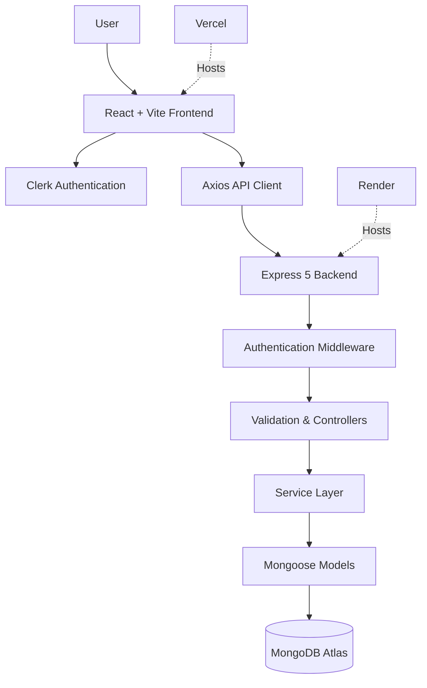

# SpendWise — Smart Personal Finance Tracker

**Take control of your money. Track smarter. Save better.**

SpendWise is a modern, full-stack personal finance management application designed to help users track income and expenses, manage monthly budgets, monitor savings goals, and gain meaningful insights into their financial activities.

Built with React, Node.js, Express, MongoDB, and Clerk, SpendWise provides a centralized platform for managing personal finances through an intuitive dashboard and secure, user-specific financial records.

<p align="center">
  <a href=https://spendwise-three-zeta.vercel.app/>Live Demo</a> ·
  <a href="#features">Features</a> ·
  <a href="#screenshots">Screenshots</a> ·
  <a href="#installation--setup">Installation</a>
</p>

---

## Live Application

🌐 **Live Project:** [Visit SpendWise](https://spendwise-three-zeta.vercel.app/)

> Replace `YOUR_LIVE_PROJECT_URL` with your deployed Vercel URL.

---

## Screenshots

Add screenshots of the application inside `docs/screenshots/` and update the image paths below.

### Dashboard

The dashboard provides an overview of financial activity, including income, expenses, remaining cash flow, and visual spending insights.


### Transaction History

Track and manage financial transactions with search, filtering, sorting, and pagination.


### Budget Management

Create monthly budgets, monitor category-wise spending, and track remaining budget limits.


### Savings Goals

Create savings targets, record contributions, and monitor progress toward financial goals.


---

## Features

### 📊 Financial Dashboard
- Overview of total income, expenses, and remaining cash flow.
- Monthly and yearly cash flow visualization.
- Category-wise expense distribution.
- Date-based financial filtering.
- Interactive charts and financial summaries.

### 💳 Transaction Management
- Add income and expense transactions.
- Edit and delete existing transactions.
- Categorize financial activities.
- Search transactions by relevant details.
- Filter by transaction type, category, wallet, and date range.
- Sorting and pagination for transaction history.

### 🎯 Budget Management
- Create monthly and category-specific budgets.
- Configure overall spending limits.
- Monitor actual spending against budget limits.
- Track remaining budget and percentage utilization.
- Identify over-budget categories.
- Prevent duplicate budgets for the same category and period.

### 🏆 Savings Goals
- Create personalized savings goals.
- Set target amounts and target dates.
- Record savings contributions.
- Monitor goal completion percentages.
- View contribution history.
- Automatically update goal progress when contributions are added.

### 🔐 Authentication & Data Security
- User authentication powered by Clerk.
- Protected backend API endpoints.
- User-specific financial data isolation.
- Server-side ownership verification.
- Secure token-based API communication.
- Environment-based configuration for sensitive credentials.

### ⚡ Additional Capabilities
- Responsive interface for desktop and mobile devices.
- Light and dark theme support.
- INR currency formatting.
- MongoDB-backed financial data persistence.
- Safe migration of supported legacy localStorage financial records.

---

## Tech Stack

### Frontend

| Technology | Purpose |
|---|---|
| React 19 | Component-based user interface |
| Vite | Development server and build tooling |
| Tailwind CSS v4 | Styling and responsive layouts |
| Axios | HTTP requests and API communication |
| Recharts | Financial charts and visualizations |
| Clerk React | Frontend authentication |

### Backend

| Technology | Purpose |
|---|---|
| Node.js | JavaScript runtime |
| Express 5 | REST API and server framework |
| Mongoose | MongoDB object modeling |
| Clerk Backend SDK | Authentication and token verification |
| Express Middleware | Validation, authentication, and error handling |

### Database & Deployment

| Technology | Purpose |
|---|---|
| MongoDB Atlas | Cloud database |
| Vercel | Frontend hosting |
| Render | Backend hosting |
| Git & GitHub | Version control and source management |

---

## Application Architecture

SpendWise follows a client-server architecture with a RESTful API.



### Data Flow

1. Users authenticate through Clerk.
2. The frontend obtains a session token.
3. Axios attaches the token to protected API requests.
4. Express middleware verifies the authenticated user.
5. Controllers and services process the requested operation.
6. Mongoose interacts with MongoDB Atlas.
7. The backend returns the requested data to the frontend.

---

## Project Structure

```text
spendwise/
│
├── client/
│   ├── public/
│   ├── src/
│   │   ├── components/
│   │   ├── hooks/
│   │   ├── services/
│   │   ├── pages/
│   │   ├── App.jsx
│   │   └── main.jsx
│   ├── .env.example
│   └── package.json
│
├── server/
│   ├── src/
│   │   ├── config/
│   │   ├── controllers/
│   │   ├── middleware/
│   │   ├── models/
│   │   ├── routes/
│   │   ├── services/
│   │   ├── validators/
│   │   ├── app.js
│   │   └── server.js
│   ├── .env.example
│   └── package.json
│
├── docs/
│   └── screenshots/
│
├── render.yaml
├── vercel.json
├── .gitignore
└── README.md
```

---

## Installation & Setup

Follow these steps to run SpendWise locally.

### Prerequisites

Make sure you have the following installed:

- Node.js 18 or later
- npm
- Git
- MongoDB Atlas account or a local MongoDB instance
- Clerk account

### 1. Clone the repository

```bash
git clone https://github.com/Ashisswain77/spendwise.git

cd spendwise
```

### 2. Install frontend dependencies

```bash
cd client
npm install
```

### 3. Install backend dependencies

Open another terminal:

```bash
cd spendwise/server
npm install
```

### 4. Configure environment variables

Create a `.env` file inside the `client/` directory:

```env
VITE_API_URL=http://localhost:5000/api/v1
VITE_CLERK_PUBLISHABLE_KEY=your_clerk_publishable_key
```

Create another `.env` file inside the `server/` directory:

```env
PORT=5000
NODE_ENV=development

MONGODB_URI=your_mongodb_connection_string
DB_NAME=spendwise

CLERK_SECRET_KEY=your_clerk_secret_key
CLERK_PUBLISHABLE_KEY=your_clerk_publishable_key

FRONTEND_URL=http://localhost:5173
```

> Use your own Clerk and MongoDB credentials. Never commit `.env` files or expose secret keys in frontend code.

### 5. Start the backend

From the `server/` directory:

```bash
npm start
```

The backend should run at:

```text
http://localhost:5000
```

Health endpoint:

```text
http://localhost:5000/api/v1/health
```

### 6. Start the frontend

From the `client/` directory:

```bash
npm run dev
```

The frontend should be available at:

```text
http://localhost:5173
```

---

## API Overview

The backend exposes RESTful endpoints under:

```text
/api/v1
```

### Transactions

| Method | Endpoint | Description |
|---|---|---|
| GET | `/transactions` | Retrieve transactions |
| POST | `/transactions` | Create transaction |
| GET | `/transactions/:id` | Retrieve transaction |
| PATCH | `/transactions/:id` | Update transaction |
| DELETE | `/transactions/:id` | Delete transaction |

### Budgets

| Method | Endpoint | Description |
|---|---|---|
| GET | `/budgets` | Retrieve budgets |
| POST | `/budgets` | Create budget |
| PATCH | `/budgets/:id` | Update budget |
| DELETE | `/budgets/:id` | Delete budget |

### Savings Goals

| Method | Endpoint | Description |
|---|---|---|
| GET | `/goals` | Retrieve goals |
| POST | `/goals` | Create savings goal |
| GET | `/goals/:id` | Retrieve goal details |
| PATCH | `/goals/:id` | Update goal |
| DELETE | `/goals/:id` | Delete goal |
| POST | `/goals/:id/contributions` | Add savings contribution |

**Authentication:** Financial API endpoints require a valid Clerk Bearer token.

---

## Financial Data Handling

SpendWise stores monetary values as integer paise to avoid floating-point precision issues.

For example:

```text
₹1       = 100 paise
₹500     = 50,000 paise
₹85,000  = 8,500,000 paise
```

The frontend converts between rupees and paise for display and API communication.

Currency formatting uses the Indian numbering system (`en-IN`) and INR currency conventions.

---

## Testing

The project includes automated backend security and integration tests.

Run backend tests:

```bash
cd server
npm test
```

Run frontend lint:

```bash
cd client
npm run lint
```

Generate a production frontend build:

```bash
cd client
npm run build
```

---

## Deployment

SpendWise is deployed using:

| Component | Platform |
|---|---|
| Frontend | Vercel |
| Backend | Render |
| Database | MongoDB Atlas |
| Authentication | Clerk |

### Deployment Configuration

**Frontend — Vercel**
- Root directory: `client`
- Build command: `npm run build`
- Output directory: `dist`

**Backend — Render**
- Root directory: `server`
- Build command: `npm install`
- Start command: `npm start`
- Health check: `/api/v1/health`

Configure all production environment variables through the respective hosting dashboards.

---

## Future Enhancements

Potential improvements for future versions include:

- Recurring transaction automation.
- Advanced financial analytics and reporting.
- CSV and PDF financial report exports.
- Custom financial insights and spending recommendations.
- Multi-currency support.
- Budget notifications and spending alerts.
- Improved data visualization and financial trends.

---

## Contributing

Contributions, suggestions, and bug reports are welcome.

1. Fork the repository.
2. Create a feature branch.

```bash
git checkout -b feature/your-feature-name
```

3. Commit your changes.

```bash
git commit -m "feat: add your feature"
```

4. Push your branch.

```bash
git push origin feature/your-feature-name
```

5. Open a Pull Request.

---

## License

This project is currently maintained as a personal development project.

A formal open-source license can be added to the repository if the project is released under one.

---

## Author

**Ashis Prasad Swain**

Computer Engineering | Full-Stack Development

- GitHub: [@Ashisswain77](https://github.com/Ashisswain77)
- Project Repository: [SpendWise](https://github.com/Ashisswain77/spendwise)

---

<p align="center">
  **SpendWise — Make every rupee count.** 💚
</p>
