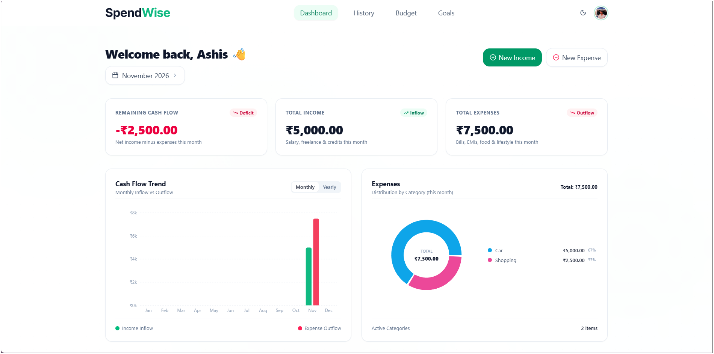

# SpendWise 

**A smart personal finance tracker to manage income, expenses, budgets, and savings goals — all in one place.**

<p align="center">
  <a href="https://spendwise-three-zeta.vercel.app/">🌐 Live Demo</a> ·
  <a href="https://github.com/Ashisswain77/spendwise">📂 GitHub Repository</a>
</p>

## 📸 Screenshots

| Main Dashboard | 

|  


## ✨ Features

- **Dashboard:** Track income, expenses, cash flow, and spending trends with interactive charts.
- **Transactions:** Create, edit, delete, search, filter, and sort financial records.
- **Budgets:** Set monthly and category-wise budgets and monitor spending limits.
- **Savings Goals:** Create financial goals, record contributions, and track progress.
- **Authentication:** Secure user authentication with Clerk and protected APIs.
- **Responsive UI:** Clean interface with light and dark themes.
- **Data Persistence:** MongoDB-backed storage with user-specific data isolation.

## 🛠️ Tech Stack

| Frontend | Backend & Database | Deployment |
|---|---|---|
| React 19 | Node.js | Vercel |
| Vite | Express 5 | Render |
| Tailwind CSS v4 | MongoDB Atlas | |
| Recharts | Mongoose | |
| Axios | Clerk | |

## 🏗️ Architecture

```text
React + Vite (Frontend)
        |
     Axios
        |
Express 5 (REST API)
        |
Authentication & Validation
        |
    Mongoose
        |
   MongoDB Atlas
```

## 🚀 Getting Started

**1. Clone the repository**

```bash
git clone https://github.com/Ashisswain77/spendwise.git
cd spendwise
```

**2. Install dependencies**

```bash
cd client && npm install
cd ../server && npm install
```

**3. Configure environment variables**

Create `.env` files in both `client/` and `server/` using the respective `.env.example` files.

Configure your MongoDB Atlas and Clerk credentials.

**4. Start the application**

Backend:

```bash
cd server
npm start
```

Frontend (in a separate terminal):

```bash
cd client
npm run dev
```

## 🔗 Deployment

- **Frontend:** [Vercel](https://vercel.com/)
- **Backend:** [Render](https://render.com/)
- **Database:** [MongoDB Atlas](https://www.mongodb.com/atlas)
- **Authentication:** [Clerk](https://clerk.com/)

## 👨‍💻 Author

**Ashis Prasad Swain**

- GitHub: [@Ashisswain77](https://github.com/Ashisswain77)
- Project: [SpendWise](https://github.com/Ashisswain77/spendwise)

---

<p align="center">
  <b>SpendWise — Make every rupee count. 💚</b>
</p>
